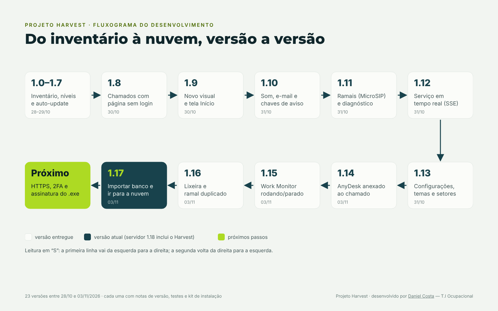

# Harvest — Inventário, chamados e termos da T.I Ocupacional

> Desenvolvido por **[Daniel Costa](https://www.linkedin.com/in/ccostadaniel/)** — T.I Ocupacional.

Sistema interno da T.I da **Ocupacional**: **inventário de máquinas Windows**, **chamados (helpdesk)**,
**solicitações de compra de equipamento**, **termos de responsabilidade assinados eletronicamente**,
**ramais (MicroSIP)** e **acesso remoto (AnyDesk)**. Escrito em **Go**, com banco **SQLite** embutido: o servidor é
**um único executável** (Windows ou Linux) e o agente é **um executável de ~8 MB** em cada estação.

> **Versão atual: servidor 1.24.0 / agente 1.22.0** — histórico completo em [`PATCH-NOTES.md`](PATCH-NOTES.md).
> Produção: **Railway** (publicado a partir do branch `main`).

## O que faz

| Área | Destaques |
|---|---|
| **Inventário** | hardware, SO, discos, rede/MAC, usuários e logons, programas instalados; **gestão do ativo** (tipo, condição, NF, valor de referência); **segurança** (BitLocker, antivírus, admins locais, última atualização); nível de saúde (OK/Alerta/Crítico); MAC e nomes duplicados; ignorar máquinas com motivo; filtros; exportação .xlsx/.csv; **Lixeira** |
| **Agente** | coleta como SYSTEM a cada 1 h, no logon e no boot; **serviço em tempo real** (SSE) que recebe atualizações, ordens de migração e a pergunta "quem está logado"; **auto-update assinado** pela T.I |
| **Chamados** | página **sem login** (máquina reconhecida pelo IP), SLA por prioridade, linha do tempo, notas internas, anexos (colar print), relatórios, aviso sonoro e **e-mail** (SMTP/M365) |
| **Solicitações de equipamento** | pedido pelo **catálogo** ou item livre → **T.I valida** → **gestor autoriza** (logado) → **Suprimentos** registra a compra → **T.I entrega** (cadastra o ativo e, se quiser, emite o termo). E-mail a cada etapa, lembrete ao gestor, sem SLA, conta nos atendimentos |
| **Termos** | **Termo de Entrega de Equipamento** (por máquina) e **Anexo II da PSI** (por pessoa) já cadastrados; **editor de termos** com versões e prévia em PDF; contas por **convite**; **Minha ficha** validada pela T.I; assinatura com **senha + código por e-mail**; identificação da máquina; evidências, hash SHA-256, **PDF** e `/verificar`; cópia ao colaborador e ao **RH** |
| **Acesso remoto** | lê o **ID do AnyDesk** de cada máquina, avisa quem não tem e anexa o ID ao chamado |
| **Ramais** | lê o **MicroSIP** de cada perfil (nunca a senha), ramal ↔ pessoa ↔ setor, aviso de ramal duplicado |
| **Active Directory** | comparativo AD × máquinas com o agente e usuários ativos (script `Sincronizar-AD.ps1`, só leitura) |
| **Administração** | menu lateral agrupado e Administração em seções; **perfis e permissões** (o que Técnico, Usuário e **perfis personalizados** — Gestor, Suprimentos… — veem); contas, auditoria, backup/importação do banco, migração de agentes, conexões, assinatura das atualizações |
| **Personalização** | tema claro/escuro, setores, **Marca** (nome, logo, favicon e cores, com contraste calculado) |

## Perfis

| Perfil | Vê |
|---|---|
| **Administrador** | tudo |
| **Técnico** | o que o administrador liberar (padrão: tudo menos Administração) |
| **Usuário** | o que o administrador liberar (padrão: Chamados, Solicitações e Meus termos); áreas de consulta são só leitura |
| **Perfis personalizados** | criados em Administração: áreas do menu + poderes (*ver as solicitações do setor*, *autorizar compras*, *registrar compras*). Vêm **Gestor**, **Gestor que autoriza** e **Suprimentos** |

## Assinatura da T.I nas atualizações (1.21+)

O agente roda como SYSTEM e se atualiza sozinho, então **só aceita versões e migrações assinadas pela T.I**.
A ferramenta `harvest-chave` (cmd/chave, roda só no PC da T.I) cria as chaves — **24 palavras** (BIP39 em
português; chave raiz Ed25519, nunca gravada) e um arquivo `.chave` com senha — e **assina cada kit** antes da
instalação. Com as palavras também se troca a chave de assinatura e se recupera o acesso ao painel (`/recuperar`).
Nenhuma chave privada vai para o servidor ou para este repositório (`*.chave` está no `.gitignore`).

## Termos: validade da assinatura

A assinatura dos termos é **eletrônica** (art. 10, § 2º, da MP 2.200-2/2001): conta pessoal + código de 6 dígitos
enviado ao e-mail corporativo, com registro de data/hora (UTC-3), IP, navegador, máquina em que a pessoa estava logada,
hash SHA-256 do texto e código de verificação conferível em `/verificar/{código}`. Não usa certificado ICP-Brasil.
O módulo exige HTTPS em produção (no servidor local há a chave "permitir HTTP" só para testes).

## Especificações (SDD)

- [`docs/SDD-1.23-TERMOS.md`](docs/SDD-1.23-TERMOS.md) — Termos de responsabilidade
- [`docs/SDD-1.24-SOLICITACOES.md`](docs/SDD-1.24-SOLICITACOES.md) — Solicitações de equipamento e perfis
- [`docs/CONTEXTO.md`](docs/CONTEXTO.md) — contexto e decisões do projeto, para retomar o desenvolvimento

## Manual de manutenção

Como operar, publicar versões, implantar o agente e recuperar o sistema:
[`docs/MANUAL-DE-MANUTENCAO.md`](docs/MANUAL-DE-MANUTENCAO.md) (também em PDF na mesma pasta).




## Compilar

Requer **Go 1.24+**. Os scripts geram o agente primeiro (ele vai **embutido** no servidor para o auto-update):

```sh
sh compilar.sh          # Linux/macOS → bin/inventario-servidor(.exe|-linux), bin/harvest-servidor(.exe|-linux), bin/inventario-agente.exe
.\compilar.ps1          # Windows (PowerShell)
```

> `go build ./...` direto não funciona sem o agente em `internal/servidor/payload/` — use os scripts.
> Testes: `go vet ./...` e `go test ./...` (incluem os fluxos completos de termo e de solicitação).

O mesmo código gera duas edições: **Ocupacional** (`inventario-servidor.exe`, padrão) e **genérica/Harvest**
(`harvest-servidor.exe`, `-ldflags "-X inventario/internal/servidor.Edicao=generica"`). `/saude` informa versão e edição.

## Instalar / atualizar

- **Servidor (Windows):** kit `Inventario-vX.Y.Z-INSTALAR-SERVIDOR.zip` de cada versão — assine com o
  `harvest-chave` e rode o `INSTALAR-SERVIDOR.bat` (pergunta IP, porta e pasta, mantém os dados, faz backup e volta
  atrás se falhar).
- **Servidor (Railway):** publica a partir do `main`. O desenvolvimento vai para o branch `desenvolvimento`
  (`ENVIAR-GITHUB.bat`); o merge para o `main` publica. O banco precisa estar num **volume** persistente.
- **Servidor (Linux):** serviço systemd — ver [`LEIA-ME.md`](LEIA-ME.md).
- **Agentes:** pacote em Administração → Agentes e instalação; depois se atualizam sozinhos.
- **Ir para outro servidor sem parar:** [`MIGRAR-PARA-NUVEM.md`](MIGRAR-PARA-NUVEM.md).

## Estrutura

```
cmd/servidor/              executável do servidor (flags, instalação como tarefa/serviço)
cmd/agente/                agente Windows (coleta, segurança, MicroSIP, AnyDesk, serviço SSE, evento "quem", auto-update)
cmd/chave/                 harvest-chave (assinatura da T.I)
internal/modelo/           formato dos dados agente ↔ servidor
internal/pdf/              gerador de PDF em Go puro (termos)
internal/assinatura/       24 palavras, certificados, manifestos
internal/servidor/         HTTP, banco SQLite, chamados, solicitações, termos, perfis, e-mail, eventos SSE
internal/servidor/web/     templates HTML, CSS/JS, fontes e os textos dos termos (web/termos)
docs/                      SDDs, contexto, manual e os modelos originais dos termos
```

## Segurança

- O repositório **não** contém binários de kit, banco de dados, senhas, tokens nem chaves (`.gitignore`:
  `kits/`, `.segredos/`, `*.chave`). O token dos agentes fica só no banco do servidor.
- Senhas com PBKDF2-SHA256, bloqueio após tentativas erradas, CSRF em todos os formulários, auditoria das ações.
- Convites de uso único (só o hash fica no banco), código de assinatura de 10 min com limite de tentativas.
- O agente nunca lê senhas (MicroSIP/AnyDesk: só ramal/ID).
