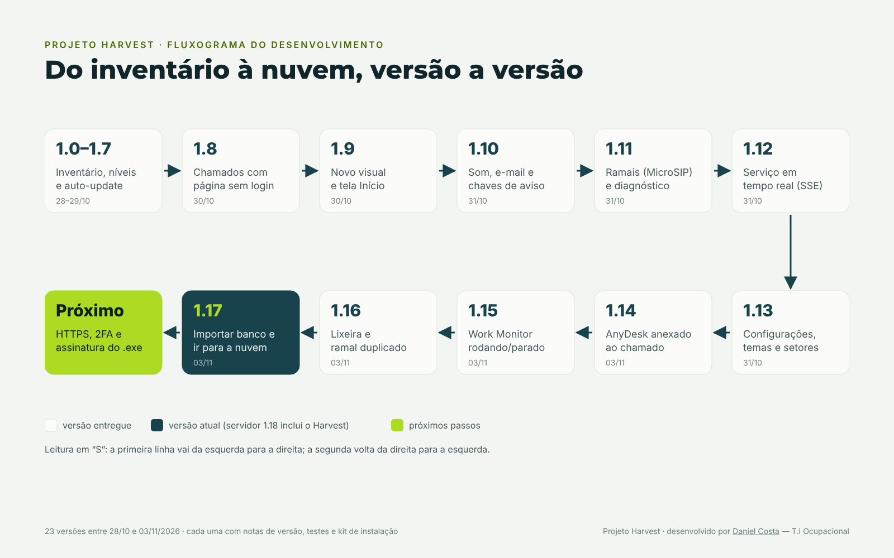

# Harvest — Inventário Ocupacional TI

> Desenvolvido por **[Daniel Costa](https://www.linkedin.com/in/ccostadaniel/)** — T.I Ocupacional.

Sistema interno da TI da **Ocupacional** para **inventário de máquinas Windows**, **chamados (helpdesk)**,
**ramais (MicroSIP)** e **acesso remoto (AnyDesk)**. Escrito em **Go**, com banco **SQLite** embutido:
o servidor é **um único executável** (Windows ou Linux) e o agente é **um executável de ~8 MB** em cada estação.

> Versão atual: **servidor 1.18.0 / agente 1.17.0** — histórico completo em [`PATCH-NOTES.md`](PATCH-NOTES.md).

## O que faz

| Área | Destaques |
|---|---|
| **Inventário** | hardware, SO, discos, rede/MAC, usuários e logons, programas instalados; nível de saúde (OK/Alerta/Crítico); MAC e nomes duplicados; filtros personalizados; exportação .xlsx/.csv |
| **Agente** | coleta como SYSTEM a cada 1 h, no logon e no boot; **serviço em tempo real** (SSE) que recebe atualizações e ordens de migração na hora; **auto-update** sem pedir administrador |
| **Chamados** | página **sem login** para os funcionários (máquina reconhecida pelo IP), SLA por prioridade, linha do tempo, notas internas, anexos (colar print), relatórios, **aviso sonoro** no navegador e **e-mail** (SMTP/M365) |
| **Acesso remoto** | lê o **ID do AnyDesk** de cada máquina, avisa quem não tem e **anexa o ID ao chamado** (botão Conectar) |
| **Ramais** | lê o **MicroSIP** de cada perfil (nunca a senha), associa ramal ↔ pessoa ↔ setor, aviso de **ramal duplicado** |
| **Programa monitorado** | confere se o **Work Monitor** (ou outro programa configurável) está instalado e **rodando** |
| **Administração** | perfis admin/técnico/usuário, auditoria, backup/importação do banco, **Lixeira** com restaurar/excluir permanente, migração de agentes para outro servidor, tokens anteriores aceitos, diagnóstico do auto-update, **Conexões** com teste de atualização |
| **Personalização** | tema claro/escuro, menu no topo ou lateral, lista de setores |

## Fluxogramas




## Compilar

Requer **Go 1.24+**. Os scripts geram o agente primeiro (ele vai **embutido** no servidor para o auto-update):

```sh
sh compilar.sh          # Linux/macOS → bin/inventario-servidor.exe, bin/inventario-servidor-linux, bin/inventario-agente.exe
.\compilar.ps1          # Windows (PowerShell)
```

> `go build ./...` direto não funciona sem o agente em `internal/servidor/payload/` — use os scripts.

## Instalar / atualizar

- **Servidor (Windows):** kit `INSTALAR-SERVIDOR.bat` de cada versão (pergunta IP, porta, pasta, mantém
  os dados, faz backup e volta atrás se falhar). Manual: `inventario-servidor.exe -instalar -porta 8080 -endereco http://IP:8080`.
- **Servidor (Linux):** serviço systemd — ver [`LEIA-ME.md`](LEIA-ME.md).
- **Agentes:** pacote em Administração → Baixar instalador; depois se atualizam sozinhos.
- **Ir para a nuvem sem parar:** [`MIGRAR-PARA-NUVEM.md`](MIGRAR-PARA-NUVEM.md).

## Estrutura

```
cmd/servidor/        executável do servidor (flags, instalação como tarefa/serviço)
cmd/agente/          agente Windows (coleta, MicroSIP, AnyDesk, programa monitorado, serviço SSE, auto-update)
internal/modelo/     formato do relatório agente → servidor
internal/servidor/   HTTP, banco SQLite, chamados, e-mail, eventos SSE, lixeira, migração
internal/servidor/web/  templates HTML + CSS/JS (tema "Bento lima", fontes embutidas)
docs/                notas de desenvolvimento
```

## Segurança

- O repositório **não** contém binários, banco de dados, senhas nem o token dos agentes (`.gitignore`).
  O token fica só no banco do servidor (Administração).
- O agente nunca lê senhas (MicroSIP/AnyDesk: só ramal/ID). Atualizações do agente rodam como SYSTEM;
  recomendação futura: assinar os executáveis (ed25519) e usar HTTPS.
