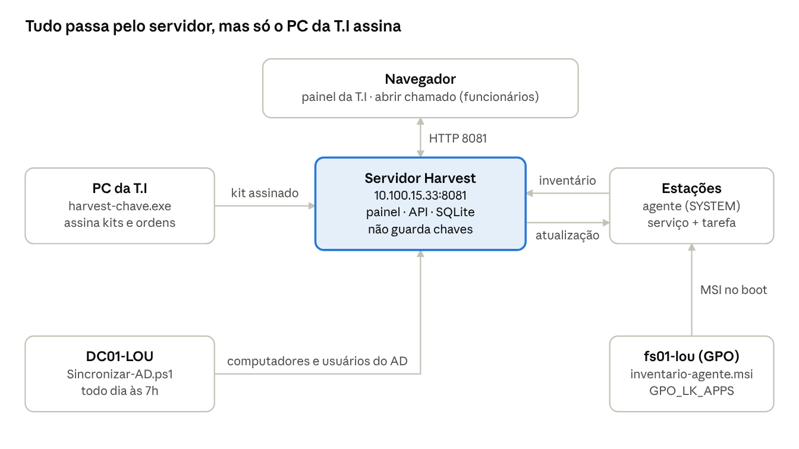

# Manual de Manutenção — Harvest

04/11/2026 · Daniel Costa

Este manual descreve como operar, atualizar e recuperar o **Harvest** (sistema de inventário, chamados e ramais da T.I Ocupacional) sem depender do autor. Cobre o servidor 1.22.0 e o agente 1.21.0.

| Campo | Valor |
| --- | --- |
| Código | TI-MAN-001 |
| Versão do documento | 1.0 |
| Sistema | Harvest — servidor 1.22.0 / agente 1.21.0 |
| Autor e responsável técnico | Daniel Costa — T.I Ocupacional |
| Aprovação | (preencher) |
| Classificação | Uso interno — T.I. Não distribuir fora da equipe. |
| Revisão | A cada nova versão do sistema |

Este documento **não contém** senhas, tokens, a chave de assinatura nem as 24 palavras. Ele diz onde cada uma está guardada e quem tem acesso.

## 1. Objetivo, escopo e público

**Objetivo:** permitir que qualquer analista da T.I mantenha o Harvest em produção: publicar versões, implantar o agente, atender ocorrências e recuperar o sistema.

**Escopo:**

- Servidor do Harvest (painel web, API dos agentes, banco SQLite).
- Agente de inventário nas estações Windows.
- Ferramenta de assinatura **harvest-chave**.
- Integração com o Active Directory e implantação por GPO.

**Fora do escopo:** desenvolvimento de funcionalidades novas (ver seção 9 para compilar) e a infraestrutura de rede em si (Omada, AD).

**Público:** analistas e administradores da T.I com acesso de administrador ao servidor, ao domínio e ao painel.

**Pré-requisitos de quem mantém:** administrar Windows Server, GPO e PowerShell; acesso ao cofre do 1Password da T.I; saber onde está o papel com as 24 palavras (seção 4).

## 2. Visão geral do sistema

O Harvest é um servidor web único (um executável, banco SQLite) que recebe o inventário de um agente instalado em cada estação Windows e oferece o painel da T.I e a página de chamados. Atualizações e mudanças de servidor só valem se assinadas no PC da T.I.



As estações enviam o inventário a cada hora e mantêm uma conexão aberta para receber atualizações na hora; o agente confere a assinatura antes de trocar o próprio executável.

| Componente | Função |
| --- | --- |
| Servidor | Painel, chamados (inclusive a página pública), API dos agentes, banco, backups |
| Agente | Coleta hardware, programas, usuários, ramais do MicroSIP, ID do AnyDesk e o programa monitorado; se atualiza sozinho |
| harvest-chave | Cria e guarda o uso das chaves da T.I; assina kits e ordens; recupera o acesso ao painel |
| Sincronizar-AD.ps1 | No DC, envia computadores e usuários do AD para o comparativo de cobertura |
| MSI + GPO | Instala o agente nas estações do domínio no boot |

Há duas edições do mesmo código: **Ocupacional** (`inventario-servidor.exe`, com a marca da empresa) e **genérica** (`harvest-servidor.exe`, com logo e cores configuráveis em Configurações → Marca). Em produção usa-se a Ocupacional.

## 3. Ambiente de produção

O servidor de produção responde em **http://10.100.15.33:8081**. Tudo o que o Harvest grava fica numa única pasta no servidor; o banco é um arquivo SQLite.

### 3.1 Servidor

| Item | Valor |
| --- | --- |
| Endereço do painel e da API | http://10.100.15.33:8081 |
| Pasta de instalação (padrão) | `C:\InventarioServidor` |
| Executável | `inventario-servidor.exe` |
| Banco de dados | `inventario.db` (+ `inventario.db-wal` e `-shm`, que andam sempre juntos) |
| Backups automáticos | `backups\inventario_AAAA-MM-DD.db` (gerado ao iniciar e diariamente) |
| Backups de manutenção | `backups\antes-de-reinstalar-*` e `backups\antes-de-importar-*` |
| Assinatura do agente | `agente.assinatura` (copiado pelo instalador) |
| Inicialização | Tarefa agendada `\Inventario\Servidor` (inicia com o Windows) |
| Firewall | Regra `InventarioServidor`, porta 8081 TCP |
| Teste de saúde | `http://10.100.15.33:8081/saude` responde `{"status":"ok", "versao": ...}` |
| Log da instalação | `instalar-servidor-AAAAMMDD-HHMMSS.txt` na Área de Trabalho de quem instalou |

### 3.2 Estações (agente)

| Item | Valor |
| --- | --- |
| Executável | `C:\Program Files\Inventario\inventario-agente.exe` |
| Dados e configuração | `C:\ProgramData\Inventario\` (`config.json`, `agente.log`, `confianca.json`, `auto-update-erro.txt`) |
| Serviço em tempo real | `InventarioAgente` ("Harvest - Agente de inventário"), conta SYSTEM |
| Coleta agendada | Tarefa `\Inventario\Agente` (SYSTEM): a cada 1 h, no logon e no boot |
| Implantação | MSI pela GPO (seção 7) |

### 3.3 Integrações

| Item | Valor |
| --- | --- |
| Pacote MSI da GPO | `\\fs01-lou\netlogon\arqv\Apps\Inventario\inventario-agente.msi` |
| GPO que instala | `GPO_LK_APPS` (pacote atribuído ao computador). A GPO `Harvest - Agente (MSI)` com o filtro WMI "Somente estações de trabalho" fica como alternativa. |
| Sincronização com o AD | Tarefa `\Harvest\Sincronizar-AD` no DC01-LOU, todo dia às 7h; log em `C:\ProgramData\Harvest\sincronizar-ad.log` |
| Código-fonte | Repositório privado no GitHub (Harvest-OCP) |
| Portas | 8081/TCP das VLANs das estações até o servidor (liberar no Omada) |

## 4. Segurança e custódia das chaves

O agente roda como SYSTEM em todas as estações e se atualiza sozinho. Por isso ele **só aceita versões e mudanças de servidor assinadas pela T.I**. As chaves de assinatura **nunca** ficam no servidor do Harvest: quem invadir o servidor não consegue mandar nada para as máquinas.

### 4.1 O que existe e onde fica

| Item | Para que serve | Onde guardar | Nunca |
| --- | --- | --- | --- |
| **24 palavras** (chave raiz) | Emitir uma nova chave de assinatura; recuperar o acesso ao painel | Papel, em cofre/gaveta trancada, com 2ª cópia em outro local físico | Foto, arquivo, e-mail, Teams, junto com o `.chave` |
| **harvest-ti.chave** + senha | Assinar cada versão e cada ordem de migração | 1Password da T.I (anexo + senha no mesmo item) | Servidor do Harvest, compartilhamentos de rede |
| **harvest-chave.exe** | Ferramenta que usa as chaves | 1Password, ou pasta onde só a T.I escreve | Pasta em que outras pessoas possam alterar o arquivo |
| Senha do `admin` do painel | Administração do painel | 1Password | Planilhas, post-it |
| Token dos agentes | Autentica as estações no servidor | Gerado pelo servidor; vai no MSI e no `config.json` | — |
| Token do AD | Autentica o script de sincronização do AD | Gerado no painel; fica no script do DC01-LOU (pasta só de administradores) | — |

### 4.2 Quem tem acesso

A custódia deve ficar com **pelo menos duas pessoas** da T.I: uma com o papel das 24 palavras e acesso ao item do 1Password, outra com a segunda cópia do papel. Registre aqui os nomes:

| Item | Responsável principal | Substituto |
| --- | --- | --- |
| 24 palavras (cópia 1) | Daniel Costa | (preencher) |
| 24 palavras (cópia 2) | (preencher) | (preencher) |
| Item "Harvest — chave de assinatura" no 1Password | Daniel Costa | (preencher) |

### 4.3 Regras

- O `harvest-chave.exe` roda **somente num PC da T.I**, nunca no servidor do Harvest.
- Antes de usar uma cópia do `harvest-chave.exe` vinda de rede, confira o hash (`Get-FileHash`) com o registrado no item do 1Password.
- Faça o teste das 24 palavras (harvest-chave, opção 6) **a cada 6 meses** e registre a data.
- Quem sair da equipe e conhecia as palavras ou a senha do `.chave`: troque a chave de assinatura (seção 8.2). Se conhecia as palavras, gere chaves novas (seção 8.3).

## 5. Uso do sistema

O painel é aberto pelo navegador em http://10.100.15.33:8081. Funcionários abrem chamados sem login em `/abrir-chamado`; a T.I entra com usuário e senha.

### 5.1 Perfis de acesso

| Perfil | Pode |
| --- | --- |
| Administrador | Tudo, inclusive Administração, Configurações globais (Marca, setores, programa monitorado), usuários do painel, assinatura e migração |
| Técnico | Chamados e inventário (consultar, editar cadastro, ignorar e excluir máquinas) |
| Usuário | Acesso restrito conforme o perfil configurado em Administração → Usuários e perfis |

Cadastre cada analista com conta própria (Administração → Usuários e perfis). Não compartilhe a conta `admin`.

### 5.2 Onde fica cada coisa

| Menu | Para que serve |
| --- | --- |
| **Início** | Chamados em aberto, prazo, saúde do parque, "Pedem atenção" e cobertura do AD |
| **Chamados** | Fila, novo chamado, relatórios. Cada chamado tem SLA, linha do tempo, notas internas, anexos e o ID do AnyDesk da máquina (botão Conectar) |
| **Inventário → Painel** | Gráficos do parque: nível OK/Alerta/Crítico, sistemas, setores, versões do agente |
| **Inventário → Máquinas** | Lista com filtros e busca; exportar .xlsx/.csv; página de cada máquina (hardware, discos, rede, logins, programas, AnyDesk, Work Monitor) |
| **Inventário → Usuários** | Logins vistos nas máquinas e em quais máquinas |
| **Inventário → Duplicados** | MAC ou nome repetido (máquina reinstalada: use Mesclar) |
| **Inventário → Notificações** | Sem AnyDesk, sem Work Monitor, disco cheio, inativa, nome genérico |
| **Inventário → Active Directory** | Estações do AD × com o agente (%), lista das que faltam, usuários ativos, planilha .xlsx |
| **Inventário → Lixeira** | Máquinas e ramais excluídos: restaurar ou excluir de vez |
| **Inventário → Conexões** | Máquinas conectadas em tempo real e teste de atualização |
| **Ramais** | Ramais do MicroSIP de cada usuário, aviso de ramal duplicado |
| **Administração** | Pacote do agente, backup, importar banco, e-mail, usuários, assinatura, migração, critérios de nível, tokens |
| **Engrenagem (Configurações)** | Tema e menu (por usuário); Marca, programa monitorado e setores (administrador) |

### 5.3 Rotinas da operação

| Situação | Como fazer |
| --- | --- |
| Máquina que não representa o parque (VM, servidor, laboratório) | Abra a máquina → **Ignorar no inventário** com o motivo. Ela sai dos números e alertas mas continua atualizando. Desfazer: **Voltar a considerar**. |
| Máquina reinstalada aparece duplicada | Abra o registro antigo → **Mesclar** no novo |
| Máquina descartada | **Excluir máquina** (vai para a Lixeira). Desinstale o agente antes, senão ela volta. |
| Conferir quem ainda está sem o agente | Inventário → Active Directory → "Sem o agente" |
| Planilha de usuários ativos | Inventário → Active Directory → ajuste os dias → **Exportar planilha .xlsx** |
| Trocar logo e cores | Engrenagem → Marca (só administrador) |
| Backup manual | Administração → **Baixar backup do banco** (pode ser com o sistema em uso) |

## 6. Procedimento padrão: publicar uma nova versão

Toda versão chega como um kit `Inventario-vX.YY-INSTALAR-SERVIDOR.zip` e segue sempre a mesma ordem: **assinar no PC da T.I → instalar no servidor → conferir**. As estações se atualizam sozinhas depois. Tempo estimado: 15 minutos, com o painel fora do ar por menos de 1 minuto.

### 6.1 Antes de começar

- [ ] Leia as notas da versão (`PATCH-NOTES.md` no código ou o LEIA-ME do kit).
- [ ] Baixe um backup: Administração → **Baixar backup do banco** (o instalador também faz um).
- [ ] Tenha à mão o `harvest-ti.chave` e a senha (1Password).
- [ ] Prefira um horário de pouco uso dos chamados.

### 6.2 Assinar o kit (no PC da T.I)

1. Descompacte o kit numa pasta do seu PC.
2. Arraste a **pasta do kit** para cima do `harvest-chave.exe`.
3. Informe o arquivo `harvest-ti.chave` e a senha.
4. Confira a saída: "chave raiz gravada em …\_servidor\_vX.YY.exe" e "agente vX.Y.Z assinado". Ele cria `arquivos\agente.assinatura`.

Se aparecer "este kit já foi assinado com OUTRA chave raiz", o kit veio de outro ambiente: baixe o original de novo.

### 6.3 Instalar no servidor

1. Copie a pasta do kit **assinado** para o servidor 10.100.15.33.
2. Dê dois cliques em `INSTALAR-SERVIDOR.bat` (ele pede administrador). Não abra o `.exe` da pasta `arquivos`.
3. Responda: IP (Enter aceita o detectado), porta (Enter = 8081), pasta (Enter = a atual) e **\[M\]anter os dados**.
4. O instalador para o servidor, faz backup, instala, libera o firewall e testa. Se o novo não subir, **volta sozinho** para a versão anterior.
5. Guarde o log `instalar-servidor-*.txt` que ficou na Área de Trabalho.

### 6.4 Conferir

- [ ] `http://10.100.15.33:8081/saude` mostra a versão nova.
- [ ] O rodapé do painel mostra a versão nova.
- [ ] Administração → Assinatura das atualizações: **"✔ Agente vX assinado pela T.I"** com a impressão da chave raiz conhecida.
- [ ] Inventário → Conexões → **Testar** (se a versão trouxer agente novo): as máquinas respondem "assinatura da T.I conferida".
- [ ] Em até 1 dia, Inventário → Painel → "Versões do agente" mostra as máquinas migrando para a versão nova.
- [ ] Administração não mostra "máquinas recusaram uma atualização por assinatura".

### 6.5 Voltar à versão anterior (rollback)

1. Rode o `INSTALAR-SERVIDOR.bat` do **kit anterior** (também assinado), com **\[M\]anter os dados**.
2. Se o banco precisar voltar: pare o servidor (`schtasks /End /TN "\Inventario\Servidor"`), mova `inventario.db*` para outra pasta, copie o backup `backups\antes-de-reinstalar-*\inventario.db` como `inventario.db` e inicie (`schtasks /Run /TN "\Inventario\Servidor"`).

Os agentes **não** voltam de versão: eles recusam versões mais antigas por segurança. Isso não impede o rollback do servidor; o agente continua funcionando com ele.

### 6.6 Quando a versão traz agente novo

O MSI da GPO pode continuar com a versão antiga: máquinas novas instalam e se atualizam sozinhas. Para manter o MSI em dia, gere-o de novo (seção 7.3).

## 7. Implantação do agente nas estações

As estações recebem o agente pelo MSI atribuído na GPO `GPO_LK_APPS`. A instalação acontece **no boot** (normalmente no 2º reinício depois de a máquina entrar no domínio), como SYSTEM, sem pedir senha ao usuário.

### 7.1 Como a GPO está montada

- Configuração do **Computador** → Políticas → Configurações de Software → Instalação de software.
- Pacote: `\\fs01-lou\netlogon\arqv\Apps\Inventario\inventario-agente.msi`, tipo **Atribuído**, sempre pelo caminho de rede (nunca `C:\`).
- "Desinstalar quando sair do escopo": **desmarcado** (máquina que muda de OU não perde o agente).
- "Sempre aguardar a rede na inicialização e no logon do computador": **Habilitado**.
- Servidores e DCs **não** devem receber o agente. Se a `GPO_LK_APPS` passar a valer para servidores, mova o pacote para a GPO `Harvest - Agente (MSI)`, que tem o filtro WMI `SELECT * FROM Win32_OperatingSystem WHERE ProductType = "1"`.

### 7.2 Conferir uma máquina

```
gpresult /r /scope computer
sc query InventarioAgente
type C:\ProgramData\Inventario\agente.log
```

O serviço deve estar **RUNNING** e a máquina aparece no painel em até 1 minuto. Para forçar: `gpupdate /force /boot` (reinicia se precisar).

### 7.3 Gerar um MSI novo

Necessário quando o token dos agentes ou o endereço do servidor mudar, ou para o MSI levar o agente mais recente.

1. Numa máquina Windows da T.I, instale o **.NET Framework 3.5** e o **WiX Toolset v3.14**.
2. No painel: Administração → Instalação do agente → **Baixar pacote (.zip)**. Ele já traz o `config.json` com o endereço e o token atuais.
3. Descompacte, entre na pasta `wix` e rode `powershell -ExecutionPolicy Bypass -File gerar-msi.ps1`.
4. Teste numa máquina: `msiexec /i inventario-agente.msi /l*v C:\Windows\Temp\harvest-msi.log`.
5. Substitua o MSI em `\\fs01-lou\netlogon\arqv\Apps\Inventario\`. Na GPO, use **Reimplantar aplicativo** no pacote se a versão mudou.

O MSI contém o token: mantenha-o só na pasta da GPO.

### 7.4 Instalar ou remover à mão

| Ação | Comando (CMD como administrador) |
| --- | --- |
| Instalar | `msiexec /i \\fs01-lou\netlogon\arqv\Apps\Inventario\inventario-agente.msi /qn` |
| Remover (instalado pelo MSI) | `msiexec /x \\fs01-lou\netlogon\arqv\Apps\Inventario\inventario-agente.msi /qn` |
| Remover (instalado de outra forma) | `"C:\Program Files\Inventario\inventario-agente.exe" -desinstalar` |
| Pausar | `sc stop InventarioAgente` + `sc config InventarioAgente start= disabled` + `schtasks /Change /TN "\Inventario\Agente" /Disable` |
| Retomar | `sc config InventarioAgente start= auto` + `sc start InventarioAgente` + `schtasks /Change /TN "\Inventario\Agente" /Enable` |

Depois de remover, exclua a máquina no painel (vai para a Lixeira).

## 8. Contingência

Cada caso abaixo tem um procedimento fechado. Em todos, registre data, responsável e o que foi feito no histórico da T.I.

### 8.1 Esqueci a senha do painel

1. Na tela de login, clique em **Esqueci minha senha** e copie o código de desafio (vale 15 minutos, uso único).
2. No PC da T.I, abra o `harvest-chave.exe` → **4) Recuperar acesso ao painel**. Digite o código e as 24 palavras.
3. Cole a resposta na página, informe o usuário administrador e a nova senha.

As palavras são digitadas só no harvest-chave, nunca no navegador. **Alternativa** com acesso ao servidor: `inventario-servidor.exe -redefinir-senha admin` (CMD como administrador, na pasta da instalação) mostra uma senha nova.

### 8.2 O harvest-ti.chave sumiu, a senha foi esquecida ou ele vazou

1. No PC da T.I: `harvest-chave.exe` → **5) Nova chave de assinatura**, com as 24 palavras. Crie a senha e salve o `.chave` novo no 1Password, apagando o antigo.
2. Quando ele pedir a pasta do kit, informe o kit da **versão instalada hoje**. Ele gera um `agente.assinatura` novo.
3. No painel: Administração → Assinatura das atualizações → envie o `agente.assinatura`.
4. Cada máquina recebe o certificado novo no próximo contato (até 1 hora) e passa a **recusar a chave antiga**.

### 8.3 As 24 palavras foram perdidas ou expostas

Enquanto o `harvest-ti.chave` existir, tudo continua funcionando, mas sem plano B. Faça nesta ordem, em até uma semana:

1. `harvest-chave.exe` → **1) Criar as chaves**: palavras novas e `.chave` novo.
2. Assine o kit da versão atual com a chave nova e reinstale o servidor com ele.
3. Gere um MSI novo (seção 7.3) e reinstale o agente em **todas** as máquinas pela GPO (Reimplantar aplicativo). Isso é necessário porque a chave raiz fica gravada dentro do agente.
4. Destrua o papel antigo (se perdido, registre a perda).

### 8.4 Servidor do Harvest invadido ou suspeito

As máquinas continuam protegidas: recusam versões e migrações sem a assinatura da T.I.

1. Isole o servidor da rede e preserve os logs para análise.
2. Monte um servidor limpo e instale o kit **assinado** da versão atual.
3. Importe o último backup confiável (Administração → Importar banco).
4. Troque as senhas de todos os usuários do painel e gere um novo token do AD (baixe o script de novo para o DC).
5. Se o endereço mudar, migre os agentes (8.5).

### 8.5 Migrar para outro servidor

1. Instale o servidor novo com o kit assinado.
2. No servidor antigo: Administração → **Baixar backup do banco**. No novo: Administração → **Importar banco de outro servidor**. O token dos agentes passa a ser o mesmo nos dois.
3. No PC da T.I: `harvest-chave.exe` → **3) Ordem de migração** com o endereço novo e o token.
4. No servidor **antigo**: Administração → Migrar os agentes → cole a ordem → **Salvar destino** → **Autorizar migração** com sua senha. Para ir por partes, use o campo canário com alguns hostnames primeiro.
5. Acompanhe "Ainda falando com este servidor". Quando chegar a zero, desligue o antigo.
6. Gere um MSI novo com o endereço novo (seção 7.3).

A ordem vale 7 dias por padrão; se vencer, gere outra.

### 8.6 Banco corrompido ("database disk image is malformed")

Causa mais comum: o `inventario.db` foi trocado e os arquivos `-wal`/`-shm` antigos ficaram na pasta, ou ele foi copiado com o servidor rodando.

1. `schtasks /End /TN "\Inventario\Servidor"`
2. Mova **todos** os `inventario.db*` para `backups\corrompido\`.
3. Copie o backup mais recente (`backups\inventario_AAAA-MM-DD.db` ou o baixado pelo painel) como `inventario.db`, sem `-wal`/`-shm`.
4. `schtasks /Run /TN "\Inventario\Servidor"` e confira o `/saude`.

Nunca copie o `inventario.db` com o servidor ligado; use sempre o **Baixar backup do banco**.

### 8.7 Servidor fora do ar

As estações guardam o inventário e reenviam no próximo ciclo; nada se perde.

1. Teste `http://10.100.15.33:8081/saude` no próprio servidor.
2. `schtasks /Query /TN "\Inventario\Servidor"` e, se parado, `schtasks /Run /TN "\Inventario\Servidor"`.
3. Se não subir, rode o `INSTALAR-SERVIDOR.bat` da versão atual com **\[M\]anter os dados** e leia o log que ele gera.

## 9. Compilar a partir do código-fonte

Só é preciso compilar para corrigir ou mudar o sistema. Uma compilação gera os executáveis **sem** a chave da T.I; eles só vão para produção depois de montados em kit e assinados (seção 6.2).

### 9.1 Requisitos

- **Go 1.24** ou mais novo.
- Cópia do repositório privado (Harvest-OCP). O token de produção não fica no repositório (aparece como `SEU_TOKEN_AQUI`).

### 9.2 Compilar

| Sistema | Comando, na raiz do projeto |
| --- | --- |
| Windows (PowerShell) | `.\compilar.ps1` |
| Linux/macOS | `sh compilar.sh` |

Não use `go build ./...` direto: o agente precisa ser compilado **antes** e fica embutido no servidor (`internal/servidor/payload/`), que é o que os scripts fazem.

Saídas em `bin\`:

| Arquivo | O que é |
| --- | --- |
| `inventario-servidor.exe` | Servidor, edição Ocupacional |
| `harvest-servidor.exe` | Servidor, edição genérica (sem marca) |
| `inventario-agente.exe` | Agente avulso |
| `agente-embutido.exe` + `versao-agente.txt` | Cópia exata do agente embutido, para o kit e para a assinatura |
| `harvest-chave.exe` | Ferramenta de assinatura |

### 9.3 Montar o kit

1. Copie o kit da versão anterior e renomeie (`Inventario-vX.YY-INSTALAR-SERVIDOR`).
2. Em `arquivos\`, troque o servidor por `Inventario_servidor_vX.YY.exe` (renomeando `bin\inventario-servidor.exe`), `inventario-agente.exe` por `bin\agente-embutido.exe` e o `versao-agente.txt`. Apague `agente.assinatura` antigo.
3. Atualize a versão no `LEIA-ME.txt` e as notas no `PATCH-NOTES.md`.
4. Compacte em `.zip` e siga a seção 6.

### 9.4 Onde mexer

| Pasta | Conteúdo |
| --- | --- |
| `cmd/agente` | Agente Windows (coleta, serviço, auto-update, `confianca.go` = verificação da assinatura) |
| `cmd/servidor` | Executável do servidor e opções de linha de comando |
| `cmd/chave` | harvest-chave |
| `internal/servidor` | Painel, API, banco, chamados, AD (`ad.go`), assinatura (`assinatura_ti.go`) |
| `internal/servidor/web` | Telas (`templates/`) e estilos (`static/`) |
| `internal/assinatura` | Criptografia: 24 palavras, certificados, manifestos |
| `internal/modelo` | Formato dos dados trocados entre agente e servidor |

Rode `go vet ./...` e `go test ./...` antes de montar o kit. A versão do agente fica em `cmd/agente/main.go` e a do servidor em `cmd/servidor/main.go`; só aumente a do agente quando o agente mudar, para não disparar atualização em todas as máquinas à toa.

## 10. Solução de problemas

Comece sempre pelo log: no servidor, o `instalar-servidor-*.txt`; na estação, `C:\ProgramData\Inventario\agente.log`; no DC, `C:\ProgramData\Harvest\sincronizar-ad.log`.

| Sintoma | Causa provável | Ação |
| --- | --- | --- |
| Máquina nova no domínio não recebe o agente | A GPO não se aplica a ela ou faltou reiniciar | `gpresult /r /scope computer`; reinicie 2 vezes (Reiniciar, não Desligar); confira o pacote **Atribuído** pelo caminho de rede |
| `gpresult` mostra a GPO "filtrada" | Filtro de segurança ou WMI | A máquina precisa de "Aplicar política" (Usuários autenticados ou Computadores do domínio) e ser estação (ProductType 1) |
| Agente instalado, máquina não aparece no painel | Rede ou porta 8081 bloqueada | Na estação: `Test-NetConnection 10.100.15.33 -Port 8081`; libere no Omada |
| Agentes não sobem de versão | Assinatura ausente ou inválida | Administração → Assinatura: envie o `agente.assinatura` correto (seção 6.2) |
| "atualização RECUSADA (assinatura)" em Administração | Kit não assinado, assinado com outra chave ou arquivo alterado | Assine o kit original de novo com o `harvest-ti.chave` atual e reinstale |
| "migração RECUSADA" no `agente.log` | Migração sem ordem assinada, ordem vencida ou para outro endereço | Gere outra ordem (harvest-chave, opção 3) e salve o destino de novo |
| Instalador: "O servidor não respondeu" + "database disk image is malformed" | Banco corrompido | Seção 8.6 |
| Instalador: "A porta 8081 está em uso" | Outro programa (ou cópia antiga) usando a porta | Feche o processo indicado no aviso ou escolha outra porta |
| Painel recusa login após muitas tentativas | Bloqueio de 10 minutos por IP | Aguarde; se a senha foi perdida, seção 8.1 |
| Aba Active Directory sem dados ou desatualizada | Tarefa do DC parada ou token do AD trocado | No DC01-LOU: `schtasks /Run /TN "\Harvest\Sincronizar-AD"` e leia o log; se "token inválido", baixe o script de novo no painel |
| Máquina aparece duas vezes | Reinstalação do Windows ou da imagem | Mesclar o registro antigo no novo (seção 5.3) |
| VM ou servidor aparece como "Crítico" | Specs baixas de propósito | Ignorar no inventário, com o motivo |
| `gerar-msi.ps1`: "candle.exe não reconhecido" | Script antigo ou WiX não instalado | Instale o WiX v3.14 e use o pacote baixado do painel atual |
| MSI instala e "some" sem mensagem | Comportamento normal: o MSI é silencioso | Confira com `sc query InventarioAgente` e no painel |

## 11. Referência rápida

Todos os comandos no CMD ou PowerShell **como administrador**.

### Servidor (10.100.15.33)

| Para | Comando |
| --- | --- |
| Parar | `schtasks /End /TN "\Inventario\Servidor"` |
| Iniciar | `schtasks /Run /TN "\Inventario\Servidor"` |
| Desligar até segunda ordem | `schtasks /End ...` + `schtasks /Change /TN "\Inventario\Servidor" /Disable` |
| Religar | `schtasks /Change /TN "\Inventario\Servidor" /Enable` + `schtasks /Run ...` |
| Ver se está no ar | abrir `http://10.100.15.33:8081/saude` |
| Nova senha do admin | `inventario-servidor.exe -redefinir-senha admin` (na pasta da instalação) |
| Instalar/atualizar | `INSTALAR-SERVIDOR.bat` do kit assinado |

### Estação

| Para | Comando |
| --- | --- |
| Estado do agente | `sc query InventarioAgente` |
| Forçar coleta | `schtasks /Run /TN "\Inventario\Agente"` |
| Ver o log | `type C:\ProgramData\Inventario\agente.log` |
| Aplicar GPO e reiniciar | `gpupdate /force /boot` |
| GPOs aplicadas | `gpresult /r /scope computer` |
| Testar a porta | `Test-NetConnection 10.100.15.33 -Port 8081` |

### Controlador de domínio

| Para | Comando |
| --- | --- |
| Sincronizar o AD agora | `schtasks /Run /TN "\Harvest\Sincronizar-AD"` |
| Instalar a sincronização | `powershell -ExecutionPolicy Bypass -File .\Sincronizar-AD.ps1 -Agendar` |
| Gerar arquivo para enviar pelo painel | `.\Sincronizar-AD.ps1 -Arquivo C:\Temp\ad-harvest.json` |

### harvest-chave.exe (PC da T.I)

| Opção | Quando |
| --- | --- |
| 1) Criar as chaves | Uma vez, ou depois de perder/expor as palavras (8.3) |
| 2) Assinar o kit | A cada versão (atalho: arrastar a pasta do kit sobre o .exe) |
| 3) Ordem de migração | Ao mudar os agentes de servidor (8.5) |
| 4) Recuperar acesso ao painel | Senha esquecida (8.1) |
| 5) Nova chave de assinatura | `.chave` perdido, senha esquecida ou vazamento (8.2) |
| 6) Conferir as 24 palavras | A cada 6 meses |

## Anexo A — Glossário

| Termo | Significado |
| --- | --- |
| Agente | Programa nas estações que coleta o inventário e envia ao servidor |
| Kit | Pasta/zip `INSTALAR-SERVIDOR` de uma versão: servidor, agente, instalador e LEIA-ME |
| Assinar o kit | Gravar a chave raiz da T.I nos executáveis e assinar o agente, no PC da T.I (harvest-chave) |
| Chave raiz / 24 palavras | Chave mestra da T.I (padrão BIP39, lista em português). Não fica gravada em lugar nenhum |
| Chave de assinatura (`harvest-ti.chave`) | Carimbo do dia a dia, protegido por senha; autorizado pela raiz por um certificado |
| Certificado | Autorização de uma chave de assinatura pela raiz. Um certificado mais novo revoga os anteriores |
| `agente.assinatura` | Arquivo que prova que o agente daquela versão foi assinado pela T.I |
| Ordem de migração | Texto assinado que autoriza os agentes a mudar para outro servidor, com validade |
| Token dos agentes | Senha que as estações usam para enviar o inventário |
| Token do AD | Senha que o script do DC usa para enviar computadores e usuários |
| Máquina ignorada | Máquina que continua no inventário mas sai dos números e alertas (VM, servidor) |
| Edição genérica | Versão "Harvest" sem a marca da Ocupacional, com logo e cores configuráveis |

## Anexo B — Histórico de versões

O detalhe de cada versão está no `PATCH-NOTES.md` do código.

| Data | Versão | Principal mudança |
| --- | --- | --- |
| 04/11/2026 | 1.22.0 | Active Directory: cobertura do agente, usuários ativos, planilha |
| 04/11/2026 | 1.21.0 | Assinatura da T.I nas atualizações e migrações; recuperação com 24 palavras |
| 04/11/2026 | 1.20.0 | Ignorar máquinas com motivo |
| 03/11/2026 | 1.19.0 | Edição genérica e painel de Marca; gerador de MSI corrigido |
| 03/11/2026 | 1.18.0 | Projeto Harvest: assinatura do autor e easter egg |
| 03/11/2026 | 1.17.0 | Importar banco e migração para a nuvem com o servidor antigo no ar |
| 03/11/2026 | 1.16.0 | Lixeira de máquinas e ramais, ramal duplicado, esconder usuários locais |
| 03/11/2026 | 1.15.0 | Programa monitorado (Work Monitor) |
| 03/11/2026 | 1.14.0 | ID do AnyDesk no inventário e nos chamados |
| 31/10/2026 | 1.13.0 | Configurações: tema, menu, setores |
| 31/10/2026 | 1.12.0 | Atualização em tempo real (serviço do agente) e teste de conexão |
| 31/10/2026 | 1.11.0 | Aba Ramais (MicroSIP) |
| 31/10/2026 | 1.10.0 | Auto-update testado, avisos de chamado por som e e-mail |
| 28/10/2026 a 30/10/2026 | 1.0 a 1.9 | Inventário, chamados, painel, auto-update |

## Anexo C — Registro de revisões deste documento

| Data | Versão do documento | Responsável | Alteração |
| --- | --- | --- | --- |
| 04/11/2026 | 1.0 | Daniel Costa | Primeira edição (sistema 1.22.0) |
